Product manager and ML engineer in Noida. I build applied AI on data nobody cleaned up first: exam-hall CCTV, helpdesk calls in Hindi and Hinglish, and the backends that put those models in front of the people who use them.

## Exam-hall integrity

There is no labelled cheating data for exam CCTV, so nothing here is trained to recognise cheating. YOLO11x-pose and ByteTrack follow every candidate, per-person rarity maths (Fisher scores over 45-second windows, plus a stand-up detector) raises what is unusual for that room, and staff, occlusion and tracking glitches are filtered out before anything reaches a reviewer.

- Finds 7 of the 14 malpractice moments confirmed by eye, at about one alert per person-hour, on a frozen benchmark with a held-out room.
- A 90-minute room of 40 candidates becomes about 60 short clips to check instead of 90 minutes of video.
- Qwen3-VL-8B looks at every seat detection once: 65 of 67 are real people, and logos and empty desks are dropped.
- Seat-anchored RTMPose-x raised people per frame from 13 to 24 but did not raise catches, so production stayed as it was.

[Live demo](https://yash752-stack.github.io/exam-integrity-demo/), with the footage pixelated so no candidate can be identified. The repository is private because the footage belongs to the exam body. I am happy to walk through it.

## Call-centre speech analytics

A live helpdesk portal paid for Gemini to transcribe and categorise every call. I replaced it with a self-hosted engine and measured it against Gemini on calls it never trained on.

- Whisper fine-tuned on helpdesk calls: 24.1% word error rate against Gemini's transcripts.
- A category model trained on about 7,200 calls Gemini had already labelled lifted sub-category agreement from 35.3% to 53.2%, and category from 75.9% to 79.1%. Gemini's choice is in its top three for 77% of calls.
- Unsure calls go to a person with the model's next two guesses, instead of a confident wrong label.
- The GPU server sleeps when idle. The portal wakes it through AWS Lambda once calls queue up, and one setting switches back to Gemini.

[Live demo](https://yash752-stack.github.io/call-analytics-demo/): play a synthetic call and see the ticket it fills, mistakes included.

## Other work

| Project | What it is |
|---|---|
| [SaaS Boilerplate](https://github.com/yash752-stack/SaaSboilerplate) | FastAPI, PostgreSQL and Stripe billing, with Celery and Redis jobs, role-based access and email verification |
| [Financial RAG Assistant](https://github.com/yash752-stack/Financial-RAG-Assistant) | Question answering over annual reports and 10-K filings; hybrid TF-IDF and BM25 retrieval, memory cut from 950 MB to 370 MB. [Live demo](https://financial-rag-assistant.streamlit.app/) |
| [ACIE](https://github.com/yash752-stack/acie-system) | Churn and lifetime-value prediction with TabTransformer and XGBoost, 91.2% AUC-ROC, tracked in MLflow and tuned with Optuna |

## Tools I use

| | |
|---|---|
| Vision | YOLO11-pose, ByteTrack, RTMPose, OpenCV, ONNX Runtime, FFmpeg |
| Speech and language | Whisper fine-tuning, Qwen3 and Qwen3-VL, Hugging Face Transformers, 4-bit quantisation, RAG |
| Backend | Python, FastAPI, Node.js, PostgreSQL, MongoDB, Redis, Celery |
| Infrastructure | AWS (EC2, Lambda, ECR, CodeBuild), Docker Compose, Nginx, Kaggle GPUs |
| Data | SQL, pandas, scikit-learn, XGBoost, MLflow, Power BI |

B.Tech in electronics and communication, LNMIIT Jaipur. CAT 98.13 percentile, XAT 93.91 percentile, LeetCode Knight.

[Email](mailto:22uec147@lnmiit.ac.in) | [LinkedIn](https://www.linkedin.com/in/yash752-stack)

  
   
  Hesitation is defeat.

